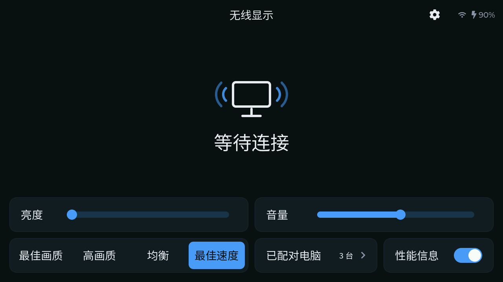

# Tab5 Wireless Display · Tab5 无线显示

[English](#english) | [中文](#中文)



---

## English

Turn an [M5Stack Tab5](https://docs.m5stack.com/en/core/Tab5) (ESP32-P4 + on-board ESP32-C6) into a wireless secondary screen for a PC.
The PC sends its picture and sound over WiFi; touches and key presses on the Tab5 go back over the same connection. Pure software — no capture card, no extra hardware.

### Features

- **Picture**: the PC's primary display, scaled to 1280×720, sent as JPEG strips (only the strips that changed) and decoded by the ESP32-P4 hardware JPEG decoder. Around 60 fps with the whole screen moving on a good 2.4 GHz link.
- **Four picture modes** on the Tab5 (best quality / high quality / balanced / best speed) trading sharpness for frame rate.
- **Sound**: whatever the PC is playing (48 kHz stereo PCM) comes out of the Tab5 speaker; volume is set on the Tab5.
- **Input back to the PC**: multi-touch is injected as real touch; an optional *touchpad mode* turns the screen into a trackpad (move, tap, drag, two-finger scroll, right click). The Tab5 Keyboard module (A164) is forwarded as a keyboard.
- **Pairing and encryption**: set a password once in the PC tray app, type it once on the Tab5. Pairing uses SPAKE2; every connection is authenticated and every message is encrypted (X25519 + ChaCha20-Poly1305). There is no plaintext mode.
- **Zero configuration**: the tray app finds the Tab5 on the LAN by UDP broadcast and connects by itself.
- The Tab5 listens from power-on, also with its screen off; the screen lights up when a picture arrives.

### What is in this repository

| Path | What |
|---|---|
| `firmware/` | Tab5 firmware (ESP-IDF v5.4.2 + LVGL 9). See [`firmware/README.md`](firmware/README.md) |
| `windisplay/PROTOCOL.md` | The wire protocol (picture, sound, touch / keyboard, pairing and encryption, discovery) |
| `windisplay/AUTH_DESIGN.md` | Design trade-offs behind pairing and encryption |
| `windisplay/sender/` | The PC side, in C#: Windows tray app `WinDisplayTray.exe` and command-line tool `wdsend`. See [`windisplay/sender/README.md`](windisplay/sender/README.md) |
| `windisplay/tools/` | Python test tools: reference sender, misbehaving sender, mock receiver, self-test |

Code comments and the detailed documents are written in Chinese.

### Requirements

- M5Stack Tab5 with the **ST7121 / ST7123** panel (newer batches). The firmware needs three frame buffers for wireless display, which is only set up for this panel; the older ILI9881C panel is not supported.
- Optional: Tab5 Keyboard (A164).
- PC: **Windows 11** with the .NET 10 desktop runtime (screen capture uses Windows.Graphics.Capture and only captures the primary display).
- Both on the same LAN. The Tab5's radio (ESP32-C6) is 2.4 GHz only.

### Quick start

1. **Build and flash the firmware** (Linux, ESP-IDF v5.4.2 installed at `~/esp/esp-idf-v5.4.2` or already exported):

   ```bash
   cd firmware
   ./build.sh        # build only (the first run also clones LVGL v9.2.2)
   ./build.sh -f     # build and flash over the Tab5's USB-JTAG port
   ```

   `./build.sh -f` looks for exactly one Espressif USB-JTAG port under `/dev/serial/by-id`; set `TAB5_PORT` if you have several (see `firmware/tools/tab5_env.sh`).

2. **Join WiFi on the Tab5**: tap the status text on the main page while it says "未联网" (not connected), or the gear icon → WiFi.

3. **Install the tray app on the PC** (on Windows, with the .NET 10 SDK):

   ```bat
   cd windisplay\sender
   dotnet publish src\WinDisplay.Tray -c Release -o "%LOCALAPPDATA%\Programs\WinDisplay"
   "%LOCALAPPDATA%\Programs\WinDisplay\WinDisplayTray.exe"
   ```

   On first run it opens its settings window; set a pairing password.

4. The tray app finds the Tab5 and connects. The first time, the Tab5 asks for the password — type the same one. After that it connects by itself.

5. **Swipe right from the left edge** of the Tab5 screen to leave the picture and return to the Tab5's own page (paused). Tap "开始显示" (start) to wait for the PC again.

### Known limits

- Windows 11 only on the PC side, primary display only; HDR displays are captured as 8-bit SDR.
- The PC keyboard layout is assumed to be US.
- One PC at a time.
- No audio/video synchronisation (sound is played as it arrives, with a small buffer) and no audio compression.
- The on-device UI is in Chinese.

### Third-party code

The MIT license in [`LICENSE`](LICENSE) covers the code written for this project. The following third-party code is included under its own license:

| Path | Origin | License |
|---|---|---|
| `firmware/components/esp_hosted/` | `espressif/esp_hosted` 1.4.0, host side, **modified** (see `LOCAL_CHANGES.md` there) | Apache-2.0 |
| `firmware/c6_slave/` | esp-hosted slave project for the on-board ESP32-C6 | Apache-2.0 |
| `firmware/components/esp_lcd/` | ESP-IDF v5.4.2 `components/esp_lcd`, **modified** (see `LOCAL_CHANGES.md` there) | Apache-2.0 |
| `firmware/components/espressif__esp_lvgl_port/` | `espressif/esp_lvgl_port`, **modified** display pipeline | Apache-2.0 |
| `firmware/components/m5stack_tab5/`, `firmware/components/esp_lcd_st7121/` | Tab5 board support package and panel driver, from the official M5Tab5 UserDemo | Apache-2.0 |
| `firmware/components/power_monitor_ina226/` | INA226 driver by Korneliusz Jarzębski | MIT |
| `firmware/main/utils/kbd_keymap.hpp` | key tables from `m5stack/M5Unit-KEYBOARD` | MIT |
| `firmware/main/ui/fonts/font_cn_*.c` | bitmap fonts generated from Noto Sans SC | SIL OFL 1.1 |

Other dependencies are fetched at build time: LVGL v9.2.2 is cloned from upstream into `firmware/dependencies/lvgl` by `build.sh`; ESP-IDF components come from the component manager (versions pinned in `firmware/dependencies.lock`); BouncyCastle, SkiaSharp and Vortice come from NuGet.

Documents and comments mention test logs (`logs/…`) and a few commit ids from the private development repository; those are not part of this repository.

### License

[MIT](LICENSE)

---

## 中文

把 [M5Stack Tab5](https://docs.m5stack.com/en/core/Tab5)（ESP32-P4 + 板载 ESP32-C6）当成电脑的无线副屏：
电脑把画面和声音经 WiFi 发过来，Tab5 上的触摸、键盘经同一条连接发回去。纯软件，不用采集卡，不加硬件。

### 功能

- **画面**：电脑主显示器的画面缩到 1280×720，切成条带压成 JPEG 发过来（只发变了的条带），Tab5 用 ESP32-P4 的硬件 JPEG 解码。2.4G 链路好的时候，整屏在动也有 60 帧/秒上下。
- **画质四档**（在 Tab5 上选）：最佳画质 / 高画质 / 均衡 / 最佳速度，在清晰度和帧率之间取舍。
- **声音**：电脑正在放的声音（48 kHz 双声道 PCM）从 Tab5 的扬声器放出来，音量在 Tab5 上调。
- **输入回传**：多点触摸在电脑上注入成真的触摸；打开「触摸板模式」后屏幕当触摸板用（挪光标、轻点、拖动、双指滚动、右键）。接了 Tab5 Keyboard（A164）的话按键也回传。
- **配对和加密**：在电脑的托盘程序里设一次密码，在 Tab5 上输一次。配对用 SPAKE2；每次连接都认证，每个报文都加密（X25519 + ChaCha20-Poly1305）。没有明文模式。
- **不用填地址**：托盘程序用 UDP 广播在局域网里找到 Tab5，自己连上去。
- Tab5 开机就在等电脑连，息屏了也照常等；电脑的画面一来自动亮屏。

### 仓库里有什么

| 路径 | 是什么 |
|---|---|
| `firmware/` | Tab5 的固件（ESP-IDF v5.4.2 + LVGL 9），见 [`firmware/README.md`](firmware/README.md) |
| `windisplay/PROTOCOL.md` | 电脑和 Tab5 之间的协议（画面、声音、触摸 / 键盘回传、配对和加密、自动发现） |
| `windisplay/AUTH_DESIGN.md` | 配对和加密的设计取舍 |
| `windisplay/sender/` | 电脑上的发送端（C#）：Windows 托盘程序 `WinDisplayTray.exe` 和命令行 `wdsend`，见 [`windisplay/sender/README.md`](windisplay/sender/README.md) |
| `windisplay/tools/` | Python 写的测试工具：测试发送端、违规发送端、模拟接收端、自测 |

代码注释和详细文档是中文的。

### 需要什么

- M5Stack Tab5，面板是 **ST7121 / ST7123** 的批次（新批次）。无线显示要三块帧缓冲，固件只给这种面板配了；旧批次的 ILI9881C 面板不支持。
- 可选：Tab5 Keyboard（A164 键盘模块）。
- 电脑：**Windows 11**，装着 .NET 10 桌面运行时（抓屏用 Windows.Graphics.Capture，只抓主显示器）。
- 两边在同一个局域网里。Tab5 的无线（ESP32-C6）只有 2.4G。

### 怎么用

1. **编译、烧录固件**（Linux；ESP-IDF v5.4.2 装在 `~/esp/esp-idf-v5.4.2`，或者已经 export 过）：

   ```bash
   cd firmware
   ./build.sh        # 只编译（头一次还会取 LVGL v9.2.2）
   ./build.sh -f     # 编译并经 Tab5 的 USB-JTAG 口烧录
   ```

   `./build.sh -f` 在 `/dev/serial/by-id` 里找 Espressif 的 USB-JTAG 口，正好一个才用；有好几个时用 `TAB5_PORT` 指定（见 `firmware/tools/tab5_env.sh`）。

2. **Tab5 连上 WiFi**：主页面写着「未联网」时点它，或者右上角齿轮 → WiFi。

3. **电脑上装托盘程序**（在 Windows 上，装着 .NET 10 SDK）：

   ```bat
   cd windisplay\sender
   dotnet publish src\WinDisplay.Tray -c Release -o "%LOCALAPPDATA%\Programs\WinDisplay"
   "%LOCALAPPDATA%\Programs\WinDisplay\WinDisplayTray.exe"
   ```

   头一次运行它会自己打开设置窗口，设一个配对密码。

4. 托盘程序自己找到 Tab5 连上来。头一次连，Tab5 上弹出密码框，输同一个密码；之后不再问。

5. **从屏幕左边缘向右滑**退出显示，回到 Tab5 自己的页面（暂停着，可以改亮度、音量、画质）；点「开始显示」接着等电脑连。

屏幕上没有电脑的画面时（等连接、暂停着）到「息屏时间」就息屏，照常等电脑连。双击顶栏手动息屏，息屏后双击屏幕亮屏。

### 已知限制

- 电脑端只支持 Windows 11，只抓主显示器；HDR 屏按 8 位 SDR 抓。
- 键盘按美式布局回传。
- 同一时刻只接一台电脑。
- 声音不做音画对齐（按到的先后放，中间隔一小段缓冲），不压缩。
- Tab5 上的界面是中文的。

### 第三方代码

[`LICENSE`](LICENSE) 里的 MIT 许可证只管本项目自己写的代码。下面这些第三方代码按它们各自的许可证收在仓库里：

| 路径 | 来历 | 许可证 |
|---|---|---|
| `firmware/components/esp_hosted/` | `espressif/esp_hosted` 1.4.0 的主机侧，**改过**（见该目录的 `LOCAL_CHANGES.md`） | Apache-2.0 |
| `firmware/c6_slave/` | 板载 ESP32-C6 上跑的 esp-hosted 从机工程 | Apache-2.0 |
| `firmware/components/esp_lcd/` | ESP-IDF v5.4.2 的 `components/esp_lcd`，**改过**（见该目录的 `LOCAL_CHANGES.md`） | Apache-2.0 |
| `firmware/components/espressif__esp_lvgl_port/` | `espressif/esp_lvgl_port`，显示管线**改过** | Apache-2.0 |
| `firmware/components/m5stack_tab5/`、`firmware/components/esp_lcd_st7121/` | Tab5 的板级支持包和面板驱动，来自官方 M5Tab5 UserDemo | Apache-2.0 |
| `firmware/components/power_monitor_ina226/` | Korneliusz Jarzębski 的 INA226 驱动 | MIT |
| `firmware/main/utils/kbd_keymap.hpp` | 键码表取自 `m5stack/M5Unit-KEYBOARD` | MIT |
| `firmware/main/ui/fonts/font_cn_*.c` | 由 Noto Sans SC 生成的点阵字库 | SIL OFL 1.1 |

其余依赖在构建时取：LVGL v9.2.2 由 `build.sh` 从上游克隆到 `firmware/dependencies/lvgl`；ESP-IDF 组件由组件管理器下载（版本钉在 `firmware/dependencies.lock` 里）；BouncyCastle、SkiaSharp、Vortice 由 NuGet 下载。

文档和注释里提到的测试日志（`logs/…`）和个别提交号来自开发时的私有仓库，没有随本仓库发布。

### 许可证

[MIT](LICENSE)
